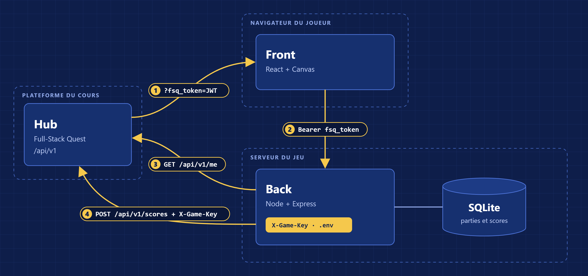

# Architecture

Le front parle uniquement au back, et seul le back appelle le hub. Le back sert aussi les fichiers
du front, donc tout est sur la même origine.

## Trajet du fsq_token

1. Le hub lance le jeu avec `?fsq_token=<JWT>` dans l'URL.
2. Le front lit le jeton puis le retire de l'URL.
3. Le front l'envoie au back dans l'en-tête `Authorization: Bearer`.
4. Le back appelle `GET /api/v1/me` pour savoir qui joue.
5. À la fin de chaque niveau, le back renvoie le jeton au hub avec le score.

Le jeton expire au bout de 2 h. Si le hub répond 401, le joueur doit relancer le jeu depuis le hub.

## X-Game-Key

La clé reste sur le serveur, dans la variable d'environnement `FSQ_GAME_KEY`. Elle sert seulement
pour `POST /api/v1/scores`. Le fichier `.env` n'est pas commité.

## Calcul du score

Le back corrige les réponses et calcule le score lui-même. Le front reçoit les questions sans les
réponses, ce qui empêche d'envoyer un faux score depuis la console du navigateur.

## Routes du back

| Route | Rôle |
|---|---|
| `GET /fsq-manifest.json` | manifeste lu par le hub |
| `GET /api/session` | vérifie le jeton et renvoie le pseudo |
| `POST /api/runs` | démarre un niveau |
| `POST /api/runs/:id/answers` | corrige un couloir |
| `POST /api/runs/:id/finish` | calcule le score et l'envoie au hub |
